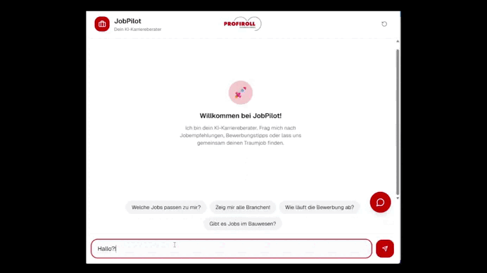

# 🤖 KI-gestützter Berufsberatungs-Chatbot

> **⚠️ Rechtlicher Hinweis:** Da dieses Framework als praxisnahes Projekt im Rahmen meines Pflichtpraktikums während der Ausbildung zum Fachinformatiker für Anwendungsentwicklung entstanden ist, unterliegt der originale Quellcode der proprietären Geheimhaltung des Praxisbetriebs. Die nachfolgende Dokumentation wurde abstrahiert und dient als technischer Deep-Dive in die Systemarchitektur, die Kern-Workflows und die gelösten Software-Hürden, ohne Betriebsgeheimnisse offenzulegen.

Ein mehrstufiges KI-System das Bewerber automatisch durch den gesamten Beratungsprozess führt – von der ersten Kontaktaufnahme bis zur Terminvereinbarung mit einem Recruiter.

---



#### Hinweis: Sollte die obige Animation nicht automatisch abspielen, befindet sich die Datei **`chatbotDemoShort.gif`** direkt im selben Ordner wie diese README und kann [hier direkt im Repository aufgerufen werden](chatbotDemoShort.gif).

---

## 📋 Projektübersicht

Dieses Projekt entstand als Proof of Concept für SF Tech und zeigt wie ein mehrstufiger KI-Workflow einen vollständigen Beratungsprozess automatisieren kann. Bewerber können jederzeit eine Anfrage starten – egal ob mit einem einfachen "Hallo" oder einer konkreten Frage nach offenen Stellen. Das System erkennt die Absicht und führt den Nutzer gezielt durch den Prozess.

---

## 🔄 Der 4-stufige Agent-Funnel

```
Nutzer → [Dispatcher] → [Matchmaker] → [DetailExpert] → [ContactAgent] → DB
                              ↑__________________|
                          (kein Interesse → zurück)
```

| Agent | Aufgabe |
|---|---|
| **Dispatcher** | Erkennt die Absicht der Nachricht und leitet gezielt weiter |
| **Matchmaker** | Durchsucht die Stellendatenbank nach passenden Jobs und Branchen |
| **DetailExpert** | Liefert Detailinfos zur Stelle, beantwortet Rückfragen |
| **ContactAgent** | Erfasst Kontaktdaten und legt den Bewerbungsdatensatz in der DB an |

---

## 🛠️ Tech Stack

**Frontend**
- Next.js 16 + TypeScript
- Tailwind CSS + shadcn/ui

**Backend / Workflow**
- n8n (Workflow-Orchestrierung)
- Webhook-Kommunikation Frontend ↔ n8n
- Session Memory (Gesprächsgedächtnis)

**KI**
- Gemini 2.0 Flash via OpenRouter
- Multi-Agent-Architektur mit klarer Aufgabentrennung

**Datenbank**
- n8n DataTable (Bewerbungserfassung)
- Stellendatenbank (Jobs + Ausbildungsplätze)

---

## ⚙️ Funktionsweise

1. **Nutzer schreibt** – egal was, auch nur "Hallo"
2. **Dispatcher** kategorisiert die Nachricht und wählt den passenden Agenten
3. **Matchmaker** sucht passende Stellen aus der Datenbank
4. **DetailExpert** beantwortet Detailfragen – bei fehlendem Interesse geht es zurück zum Matchmaker
5. **ContactAgent** erfasst Kontaktdaten und Präferenzen (Telefon/E-Mail) und speichert den Datensatz

---

## 💾 Datenbankstruktur

**Bewerbungstabelle** (`bewerbungen`):
```
name | telefon | email | interessen | jobs | status | kontaktweg
```

**Stellendatenbank:**
- `jobs` – reguläre Stellenangebote
- `azubi_jobs` – Ausbildungsplätze
- `azubi_branche` – Branchenzuordnung

---

## 🧠 Learnings

- **Präzises Prompting ist entscheidend** – vage Anweisungen führten zu falschen Agent-Weiterleitungen und unerwarteten Antworten
- **Klare Agenten-Trennung reduziert Halluzinationen** – je spezifischer die Aufgabe, desto zuverlässiger die Antwort
- **Session Memory in der Praxis** – erste praktische Erfahrung mit KI-Gesprächsgedächtnis in mehrstufigen Dialogen
- **Vorauswahl verbessert Trefferqualität** – bei großen Datenmengen ist eine strukturierte Filterung entscheidend. Diese Erkenntnis war direkte Vorstufe zum RAG-Ansatz im späteren Abschlussprojekt

---

## 🚀 Ausblick

- Vektordatenbank für semantische Stellensuche (statt exakter Datenbankabfragen)
- Authentifizierung und Nutzerverwaltung
- E-Mail-Benachrichtigung bei neuer Bewerbung
- Dashboard für Recruiter

---

## 📁 Projektstruktur

```
├── frontend/          # Next.js App
│   ├── app/
│   ├── components/
│   └── ...
├── workflow/          # n8n Workflow Export
│   └── LGroupChatbot_OKU.json
└── assets/
    ├── demo.gif
    └── workflow.png
```


