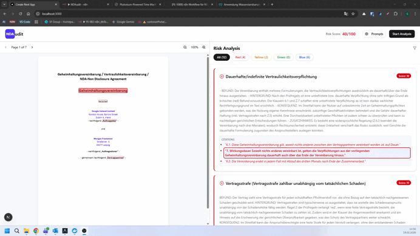

# ⚖️ NDAudit - Agentic AI Workflow Framework for Contract Analysis

> **⚠️ Rechtlicher Hinweis:** Da dieses Framework als praxisnahes Projekt im Rahmen meines mandatory Praktikums während der Ausbildung zum *Fachinformatiker für Anwendungsentwicklung* entstanden ist, unterliegt der originale Quellcode der proprietären Geheimhaltung des Praxisbetriebs. Die nachfolgende Dokumentation wurde abstrahiert und dient als technischer Deep-Dive in die Systemarchitektur, die Kern-Workflows und die gelösten Software-Hürden, ohne Betriebsgeheimnisse offenzulegen.

> **💡 Praktikums-Showcase (2025/2026):**
> Dieses Projekt demonstriert eine hochgradig kostenoptimierte und ausfallsichere LLM-Pipeline innerhalb von n8n. Durch den Einsatz von intelligentem Pre-Filtering (Multi-Agenten-Ansatz) und modularer Datenaufbereitung via JavaScript-Nodes wird eine präzise, juristische Textanalyse bei minimalem Token-Verbrauch realisiert.

---

## 🎯 Architektur & Workflow-Logik

#### Hinweis: Sollte die obige Animation nicht automatisch abspielen, befindet sich die Datei **`Demo_NDAudit.gif`** direkt im selben Ordner wie diese README und kann [hier direkt im Repository aufgerufen werden](Demo_NDAudit.gif).

Der Workflow verarbeitet eingehende Dokumente asynchron über eine REST-Schnittstelle und durchläuft sechs klar definierte Phasen:

### 1. Datenaufbereitung & „Text-Heilung“ (`DataExtractor`)
Um Formatierungsfehler durch PDF-Parser zu eliminieren, bereinigt eine JavaScript-Node den rohen Text per Regex (Entfernung von Page-Breaks, Korrektur unnatürlicher Zeilenumbrüche). Anschließend schneidet ein logischer Algorithmus den bereinigten Text in satzkonforme Segmente (*Sentence-Aware Chunks*), um Token-Limits strikt einzuhalten.

### 2. Die Vor-Analyse-Schleife (`Looper` & `ChunkAgent`)
Anstatt den gesamten Vertragstext für jede einzelne Prüfregel an teure LLMs zu senden, durchläuft das System eine ressourcenschonende Schleife:
- Der **ChunkAgent** (GPT-4o-mini) prüft die Textsegmente zügig auf Relevanz bezüglich einer bestimmten Kategorie (z. B. "Haftung").
- Er gibt ausschließlich die Indizes der relevanten Chunks als schlankes JSON-Array zurück.
- *Besonderheit:* Der Agent ist so instruiert, dass er essenzielle Kontext-Definitionen (z. B. Vertragsparteien) automatisch miterfasst.

### 3. Kontext-Fokussierung (`FocusBuilder` & `If-Node`)
Eine Code-Node aggregiert die vom Vor-Analysten gewählten Indizes und baut einen stark verkürzten, fokussierten Textkontext zusammen. Existiert eine Kategorie im gesamten Dokument nicht, bricht eine nachfolgende If-Node den Workflow für diese Regel sofort effizient ab.

### 4. Die Tiefenprüfung (`RulesAgent`)
Die eigentliche juristische Detailprüfung wird vom **RulesAgent** (GPT-5-mini) durchgeführt. Dieser arbeitet exklusiv auf dem komprimierten Kontext des FocusBuilders:
- Abgleich gegen spezifische Severity-Rules zur Einstufung des Risikograds (*Red, Yellow, Green*).
- Generierung eines strikt strukturierten Reasonings (*Befund, Hintergrund, Konsequenz*).
- Extraktion 1:1 wortgetreuer Originalzitate (*Citations*) zur späteren Highlight-Darstellung im Frontend.

### 5. Das "Fangnetz" für unkonventionelle Gefahren (`SilentRiskAgent`)
Um zu verhindern, dass die KI bei der Prüfung starrer Regelwerke andere kritische Klauseln fälschlicherweise markiert, wurde ein exklusives Sicherheitsnetz integriert. Der **SilentRiskAgent** erhält den gesamten Vertragstext sowie eine Sperrliste aller bereits gefundenen Zitate. Er sucht gezielt und isoliert nach unüblichen, einseitigen Benachteiligungen (*Silent Risks*, Bewertung: *Blue*), die in keinem Standard-Regelset definiert sind.

### 6. Finalisierung & Datenbereinigung (`FinalFormatter`)
Abschließend führt eine JavaScript-Node die Ergebnisse des iterativen Loops und des Silent-Risk-Agenten zusammen. Die Datenstruktur wird bereinigt, Duplikate innerhalb der Citations werden entfernt, und die Funde werden priorisiert nach Schweregrad (kritische Treffer zuerst) als sauberes JSON-Paket an das Frontend zurückgesendet.

---

## 🛠️ Tech Stack & Komponenten
- **Orchestrierung:** n8n (Advanced Workflow Logic, Split-In-Batches, Aggregate Nodes)
- **AI Engine:** LangChain Integration in n8n via OpenRouter (GPT-4o-mini, GPT-5-mini)
- **Logik & Data-Shaping:** JavaScript (ES6+) innerhalb n8n-Code-Nodes
- **Schnittstellen:** REST Webhook (mit CORS-Header-Konfiguration für lokale Frontend-Anbindung)

---

## 🧠 Software-Engineering Insights & Stabilität (Stand 2026)

* **Token- & Kosten-Effizienz:** Durch das vorgeschlagete Chunk-Filtering via `FocusBuilder` konnte das Datenaufkommen für den teureren Haupt-Agenten um bis zu 70% reduziert werden, was die Betriebskosten der Pipeline drastisch minimiert.
* **Robuste LLM-Formatierung:** Da LLM-Ausgaben trotz strikter System-Prompts zu unerwarteten Formatierungsfehlern neigen, fängt die `AgentParser`-Node Syntaxfehler (wie fehlerhafte oder unvollständige Markdown-Code-Blocks) ab. Über einen JavaScript-basierten Fallback-Mechanismus wird garantiert, dass das System immer ein valides JSON-Array ausgibt und der Workflow niemals unkontrolliert abbricht.
* **Native DB-Entkopplung:** Die n8n-Workflows wurden architektonisch so adaptiert, dass sie komplett zustandslos und entkoppelt agieren. Dadurch bleibt die Automatisierungs-Pipeline maximal flexibel und funktioniert nativ mit minimalen Anpassungen, falls das angebundene Datenbanksystem im produktiven Umfeld ausgetauscht wird.

---

## 🔮 Zukünftige Roadmap
- **Erweitertes Vektor-Caching:** Zwischenspeichern bereits analysierter Vertragsklauseln in einer Vektordatenbank, um wiederkehrende Standard-Klauseln ohne erneuten LLM-Aufruf instantan zu validieren.
- **Human-in-the-Loop (HITL):** Optionale Integration von n8n-User-Nodes, um kritische Risikobewertungen (z. B. *Red*-Klauseln mit extrem hoher Haftung) vor der finalen Frontend-Ausgabe durch ein manuelles Review freizugeben.