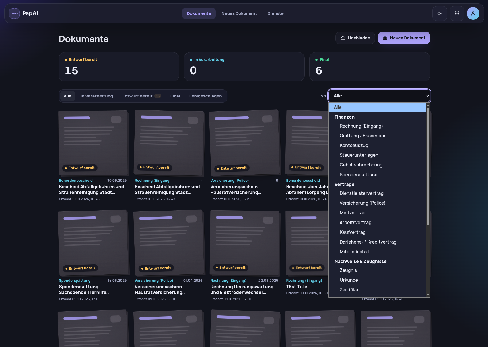
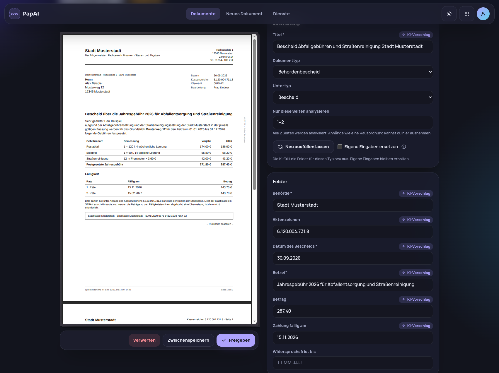
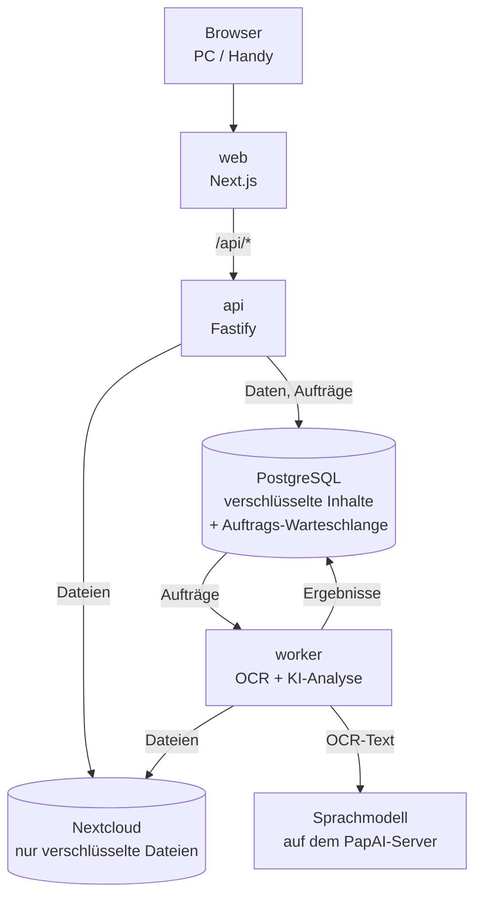

# 📄 PapAI – Verschlüsseltes Dokumentenarchiv mit selbstgehosteter KI

> **💡 Eigenprojekt (seit Ende September 2026, aktiv in Entwicklung):**
> PapAI macht aus Papierdokumenten (Handyfoto oder PDF) ein durchsuchbares, verschlüsseltes
> Archiv. Texterkennung und KI-Analyse laufen auf dem PapAI-Server statt bei einem KI-Anbieter;
> Dokumentinhalte verlassen ihn nie unverschlüsselt. Stand: **Phase 1** – ein Nutzer, die
> Verarbeitungs-Pipeline ist fertig.

---

## 🏠 Problem & Ansatz

Rechnungen, Verträge und Bescheide liegen verstreut in Ordnern. Digitale Lösungen schicken diese
hochsensiblen Daten meist an Cloud-Dienste und externe KI-APIs.

PapAI geht den umgekehrten Weg – **Privatsphäre ist die Grundlage, nicht ein Zusatz:**

1. Foto oder PDF hochladen; Fotos werden automatisch zugeschnitten und ausgerichtet.
2. OCR erzeugt ein durchsuchbares Archiv-PDF.
3. Ein selbstgehostetes Sprachmodell erkennt den Dokumenttyp und schlägt die passenden Felder vor
   (z. B. Rechnungsnummer, Betrag, Kündigungsfrist).
4. Der Nutzer prüft, korrigiert und gibt frei.

Dateien, OCR-Text und Feldwerte werden durchgehend **verschlüsselt** gespeichert.

---

## 📺 Einblick

**Dokumentliste:** Typ, Titel, Datum und Status auf einen Blick, filterbar nach Status und nach
25 Dokumenttypen in Gruppen (Finanzen, Verträge, Nachweise …).

**„Entwurf prüfen“:** PDF und Formular nebeneinander. KI-Werte tragen die Markierung
„KI-Vorschlag“, Pflichtfelder (*) müssen vor der Freigabe gefüllt sein. Seiten wie AGB lassen sich
von der Analyse ausnehmen; „Neu ausfüllen lassen“ startet die KI erneut, ohne eigene Eingaben zu
überschreiben.

> Alle gezeigten Dokumente sind fiktiv.

---

## 📐 Architektur

- **web (Next.js):** nur Oberfläche, leitet `/api/*` an die API weiter.
- **api (Fastify):** Sitzungen, Eingabeprüfung per Zod, OpenAPI-Doku („API-First“, z. B. für eine
  spätere Mobil-App). Lange Arbeit (OCR, KI-Analyse) legt sie als Auftrag in einer Warteschlange in der Datenbank ab, statt sie selbst zu
  erledigen.
- **worker:** holt die Aufträge ab (Warteschlange mit pg-boss), lädt die verschlüsselte Datei aus der Nextcloud,
  entschlüsselt sie im Arbeitsspeicher, führt OCR aus und schickt den Text an das Sprachmodell.
  Ergebnisse speichert er verschlüsselt. So bleibt die API auch bei langen Analysen reaktionsfähig.
- **@papai/shared:** Schemas, Dokumenttyp-Katalog und Validierung, die Frontend und Backend
  gemeinsam nutzen – eine Regel, eine Stelle.

pnpm-Monorepo, alle Dienste containerisiert mit Podman Compose.

---

## 🛠️ Verarbeitung im Detail

- **Upload-Prüfung:** Dateityp über Magic Bytes statt Endung, Größe, Seitenzahl, Passwortschutz,
  Duplikate per HMAC.
- **Bildaufbereitung:** automatischer Zuschnitt und Ausrichtung (OpenCV, sharp), manuell
  korrigierbar.
- **OCR:** OCRmyPDF und Tesseract; Zwischendateien nur im Arbeitsspeicher (tmpfs).
- **KI in zwei Schritten:** Erst ordnet das Modell das Dokument einem von 25 Typen zu, dann
  bekommt es nur die Felder dieses Typs und ein passendes Antwortschema. Lange Dokumente werden in
  Abschnitte geteilt.
- **Belegprüfung gegen Halluzinationen:** Jeder Wert muss im OCR-Text stehen, nah an der passenden
  Beschriftung und im richtigen Format – sonst wird er verworfen. Daten und Beträge werden
  vereinheitlicht („3. Apr. 26“ → `2026-04-03`).
- **Robust:** Vorübergehende Fehler werden mit Backoff wiederholt, liegengebliebene Aufträge nach
  einem Neustart neu eingereiht; eine unbrauchbare KI-Antwort ergibt einen Teil-Entwurf statt eines
  Abbruchs.

---

## 🔐 Sicherheit

- **Envelope Encryption (AES-256-GCM):** eigener Schlüssel pro Datei, gesichert mit einem
  Master-Schlüssel. Die Nextcloud sieht nur verschlüsselte Dateien mit ID-Namen.
- **Verschlüsselte Metadaten:** Typ und Feldwerte liegen als ein Block pro Dokument in der
  Datenbank, an die Dokument-ID gebunden und auf feste Größen aufgefüllt, damit die Länge nichts
  verrät. Im Klartext stehen nur Status und Zeitstempel.
- **Kein externer KI-Dienst:** Der Worker startet nur, wenn das Sprachmodell unter einer privaten
  Adresse erreichbar ist; Inhalte erscheinen nie in Logs.
- **Ausweise:** Erkennt die KI ein Ausweisdokument, werden keine Inhalte gespeichert.
- **Zugang heute:** argon2-Passwort-Hash, serverseitige Sitzungen (Cookie `httpOnly`, `secure`,
  `SameSite=strict`), Sperre nach Fehlversuchen; Datenbank und API nicht von außen erreichbar.
- **Ehrliche Grenze:** Der Master-Schlüssel liegt auf dem Server. Die Verschlüsselung schützt
  Datenbank, Backups und Speicher, nicht gegen jemanden mit Zugriff auf den laufenden Server –
  dafür ist der Tresor geplant (siehe Roadmap).

**Bewusst ohne Keycloak und Kong.** Beide habe ich geprüft. Identität übernimmt künftig das
selbstgehostete Supabase Auth, das ohnehin zur Datenbank gehört; Sitzungspflicht, Eingabeprüfung
und Ratenbegrenzung die Fastify-API; TLS ein Reverse Proxy. Jeder weitere Dienst wäre zusätzliche
Angriffsfläche ohne zusätzlichen Nutzen – das Projektprinzip „Einfachheit“ verlangt für jede neue
Komponente eine Begründung.

---

## 🧠 Engineering Insights

**Messbare KI-Qualität.** Ein Entwicklungs-Testsatz aus 17 fiktiven Dokumenten mit Sollwerten ist
gegen Überanpassung geteilt: 11 zum Optimieren, 6 werden dabei nicht angesehen. Gemessen auf dem
Dokumenttext mit Qwen 3.5 9B:

| Teil | Felder | richtig | falsch eingetragen |
| --- | --- | --- | --- |
| Optimierteil (Ø aus 4 Läufen) | 131 | 124 (94,7 %) | 5 Werte in 4 Läufen |
| Prüfteil (Ø aus 2 Läufen) | 27 | 23 (85 %) | 0 |

Ein leeres Feld zählt als fehlend, nicht als falsch – gewollt, denn ein leeres Feld fällt beim
Prüfen auf, ein falscher Wert nicht. Das ist ein Entwicklungsstand, keine allgemeine Genauigkeit:
Zwei Prüfdokumente wurden bei der Fehlersuche inzwischen angesehen, ein Satz mit echten Dokumenten
steht noch aus.

- **Modellvergleich:** Gemma 4 12B füllte im Prüfteil mehr Felder (26 / 27), trug aber 4 falsche
  Werte ein und brauchte doppelt so lange; Ministral 3 8B ließ deutlich mehr leer. Qwen bleibt
  vorerst Standard, weil es keinen falschen Wert eintrug.
- **Laufzeit:** 9–23 Sekunden KI-Analyse pro Dokument (Ryzen 5 5600X, Radeon RX 9070 XT). Ziel der
  Spezifikation: unter 5 Minuten bis zum Entwurf auch ohne GPU (8 Kerne, 32 GB RAM).
- **Prüfregeln statt Prompt-Flickwerk:** KI-Fehler werden über die Belegprüfung und Hinweise am
  Feld behoben, nicht mit immer neuen Einzelfällen im Prompt.
- **Spezifikationsgetrieben:** Jedes Feature durchläuft Spezifikation, Plan und Aufgabenliste
  (GitHub Spec Kit); eine Projektverfassung macht Privatsphäre zum nicht verhandelbaren Prinzip.
- **KI-gestützte Entwicklung:** Umsetzung mit Claude Code; Architektur, Spezifikation,
  Sicherheitsentscheidungen und Review liegen bei mir.
- **Eigenes Design-System:** Bausteine und Gestaltungswerte (zwei Paletten, Hell/Dunkel,
  automatische Kontrastprüfung) getrennt von der Fachlogik, wiederverwendbar für weitere Projekte.

---

## 🧰 Tech Stack

- **Frontend:** Next.js 16, React, TypeScript, Tailwind CSS, TanStack Query, React Hook Form
- **Backend:** Node.js, Fastify, Zod, Drizzle ORM, pg-boss, pino
- **Daten:** PostgreSQL (Supabase-Image), Nextcloud über WebDAV
- **Dokumente:** OCRmyPDF, Tesseract, OpenCV, sharp, pdf-lib
- **KI:** OpenAI-kompatible Schnittstelle, getestet mit LM Studio und Qwen 3.5 9B
- **Sicherheit:** AES-256-GCM, argon2
- **Infrastruktur:** Podman Compose, pnpm-Workspaces, Vitest, ESLint, Prettier

---

## 🔭 Vision & Roadmap

**Ziel:** Die eigenen Dokumente von überall sicher erreichen – gespeichert auf dem eigenen Server
oder NAS statt bei großen Cloud-Anbietern.

- **Speicher nach Wahl:** heute Nextcloud, später weitere Systeme (z. B. S3-kompatibel). Der
  Speicher sieht immer nur verschlüsselte Dateien.
- **So viel Zero Knowledge wie möglich:** Der **Tresor** (nächstes Feature) verschlüsselt
  besonders sensible Dokumente schon im Browser; der Server sieht dann weder Inhalt noch Titel
  noch Typ. Einzige bewusste Ausnahme ist die KI-Analyse: Sie braucht den Text und läuft deshalb
  auf dem PapAI-Server statt bei einem KI-Anbieter.
- **Mehrere Nutzer & Betrieb:** Supabase Auth mit Einladecodes und Rollen, Row Level Security,
  Reverse Proxy mit TLS als einziger offener Dienst, Backups.
- **Ordnen & Finden:** Absender, Tags und „für wen“ (Privat, Gewerbe, Verein); KI-Steckbrief mit
  Suchindex nur im Arbeitsspeicher; Markierung der KI-Fundstellen im PDF.
- **Langfristig – vom Archiv zum Assistenten:** Erinnerungen an Fristen (19 Fristfelder sind im
  Katalog schon dafür markiert), Steuervorbereitung mit steuerrelevanten Belegen pro Jahr,
  Kalender-Export, Übersicht laufender Verträge und Kosten.
